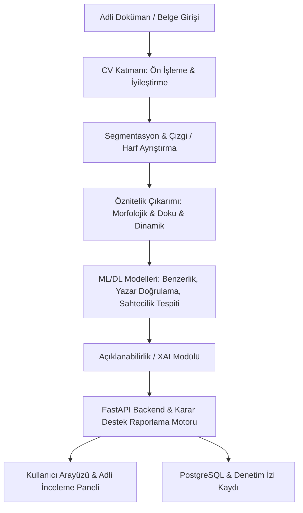

# Forensic Handwriting Decision Support System (FHDSS)

Yapay Zekâ Tabanlı, Modüler, Açıklanabilir (XAI) ve Denetlenebilir Adli Belge ve El Yazısı İnceleme Karar Destek Sistemi.

---

## 🎯 Proje Vizyonu ve Amacı

Adli el yazısı ve imza incelemelerinde adli bilirkişilerin karar süreçlerini destekleyen; nesnel, matematiksel temellere dayalı, açıklanabilir (Explainable AI - XAI) ve geriye dönük tam denetlenebilirlik (Chain of Custody / Audit Trail) sunan yeni nesil bir karar destek sistemidir.

### Temel Prensipler
- **Açıklanabilirlik (Explainability / XAI):** "Kara kutu" model yaklaşımı yerine görsel ısı haritaları (Grad-CAM, Score-CAM), morfolojik özellik haritaları ve karar metrikleri sunar.
- **Denetlenebilirlik & Güvenilirlik:** Yapılan her analizi girdi hash'leri, model versiyonları ve işlem adımlarıyla kayıt altına alan denetim izi (Audit Trail).
- **Modüler Mimari:** Ön işleme, öznitelik çıkarımı, model eğitimi, doğrulama ve API katmanlarının bağımsız ve genişletilebilir yapısı.

---

## 🏗️ Mimari Yapı



---

## 📂 Dizin Hiyerarşisi

```text
├── backend/                  # API Servisleri (FastAPI)
│   ├── app/                  # Uygulama kaynak kodları
│   └── tests/                # Backend birim & entegrasyon testleri
├── cv/                       # Bilgisayarlı Görü (Computer Vision) Hattı
│   ├── preprocessing/        # Gürültü giderme, binarizasyon, skew düzeltme
│   ├── segmentation/         # Satır, kelime ve karakter segmentasyonu
│   └── features/             # Morfolojik, geometrik ve doku öznitelikleri
├── ml/                       # Makine Öğrenmesi & Derin Öğrenme Hattı
│   ├── datasets/             # PyTorch / TF Dataset & DataLoader tanımları
│   ├── models/               # Model mimarileri (Siamese, ResNet, ViT vb.)
│   ├── training/             # Eğitim döngüleri ve kayıp fonksiyonları
│   ├── evaluation/           # Değerlendirme metrikleri (FAR, FRR, EER, AUC)
│   └── explainability/       # Açıklanabilirlik modülleri (CAM, XAI, Feature Attribution)
├── frontend/                 # Web tabanlı adli inceleme ve karar destek arayüzü
├── datasets/                 # Veri Deposu
│   ├── raw/                  # Ham taranmış belgeler ve el yazıları
│   ├── validated/            # Kontrol edilmiş ve temizlenmiş veriler
│   ├── processed/            # İşlenmiş ve normalize edilmiş görüntüler
│   └── splits/               # Train / Val / Test bölütleri ve meta veriler
├── artifacts/                # Model ağırlıkları, önbellek ve audit logları
├── reports/                  # Üretilen adli analiz ve karar destek raporları
├── docs/                     # Sistem ve adli metodoloji dokümantasyonu
├── scripts/                  # Veri hazırlama ve yardımcı operasyonel betikler
└── tests/                    # Uçtan uca sistem testleri
```

---

## 🚀 Kurulum ve Başlangıç

### 1. Gereksinimler
- **Python:** 3.11+ / 3.12 (veya 3.13)
- **Node.js:** v20+ / v22+
- **PostgreSQL:** 16+
- **Docker & Docker Compose** *(Opsiyonel)*

### 2. Sanal Ortam ve Bağımlılıklar
```bash
# Sanal ortamı aktif edin
.venv\Scripts\activate

# Ortam değişkenlerini hazırlayın
cp .env.example .env
```

### 3. Docker ile Veritabanını Başlatma
```bash
docker compose up -d db
```

---

## ⚖️ Adli Standartlar & Yasal Uyumluluk
Sistem, bilirkişinin nihai kanaat oluşturma sürecinde rehberlik eden **yardımcı bir karar destek mekanizmasıdır**. Tüm çıktılar doğrulanabilir öznitelikler, metrikler ve karşılaştırmalı görsel kanıtlarla birlikte sunulur.
